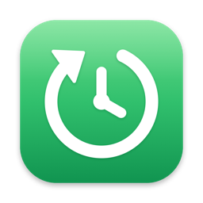
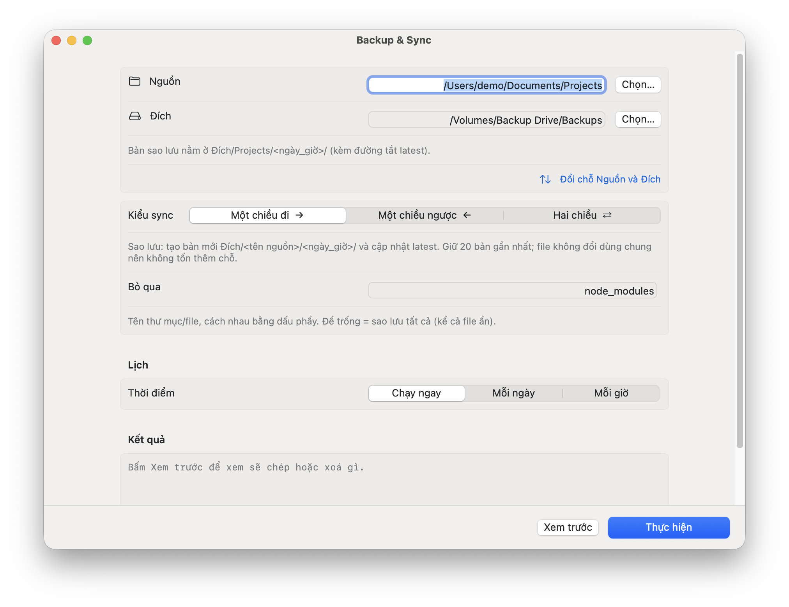

# Backup & Sync

App trên máy Mac giúp bạn **sao lưu một thư mục** (ví dụ thư mục dự án, tài liệu) **sang ổ cứng ngoài**, và **lấy lại file** khi cần. Có thể bấm chạy ngay hoặc hẹn giờ cho app tự chạy mỗi ngày.



**Điểm chính**

- Sao lưu mọi thứ trong thư mục, kể cả file ẩn.
- Mỗi lần sao lưu là một bản riêng, ghi theo ngày giờ. App giữ 20 bản gần nhất, nên bạn có thể lấy lại file của những hôm trước.
- File không thay đổi thì không bị chép thêm lần nữa, nên nhiều bản sao lưu cũng không tốn thêm chỗ.
- Khi lấy lại file, app **không bao giờ ghi đè file mới hơn** và **không xoá gì** trên máy bạn.
- Luôn cho bạn xem trước sẽ chép những gì, và hỏi lại trước khi chạy.

---

## Cài đặt

Cần máy Mac chạy **macOS 13 (Ventura) trở lên**.

1. Vào trang [**Tải về**](https://github.com/mrtuanphong/backup-sync-app/releases/latest), bấm vào file **Backup-and-Sync-….zip** để tải.
2. Mở file zip vừa tải (thường nằm trong thư mục **Downloads**), sẽ thấy app **Backup & Sync**.
3. Kéo app vào thư mục **Applications** (Ứng dụng). Nên để app ở đây vì nếu sau này dời app sang chỗ khác, các lịch hẹn giờ sẽ không chạy nữa.
4. Mở app từ thư mục Applications.

> [!IMPORTANT]
> **Lần mở đầu tiên, bạn phải bấm "Open Anyway" trong System Settings.**
> App không tải từ App Store nên macOS sẽ báo *"Backup & Sync" Not Opened* và chưa cho mở. Đây là cảnh báo bình thường, không phải lỗi hay virus. Cách mở:
> 1. Bấm **Done** để đóng thông báo.
> 2. Mở **System Settings** (Cài đặt hệ thống) → **Privacy & Security** (Quyền riêng tư & Bảo mật), kéo xuống mục **Security**.
> 3. Bấm **Open Anyway** cạnh dòng *"Backup & Sync" was blocked…*, nhập mật khẩu máy, rồi bấm **Open Anyway** lần nữa.
>
> Chỉ cần làm một lần. Những lần sau app mở bình thường.

Nếu máy hiện thông báo hỏi cài **Command Line Tools** thì bấm **Install** và chờ cài xong (vài phút, cần mạng). App cần công cụ miễn phí này của Apple để chạy. Mỗi máy chỉ cài một lần.

---

## Cách dùng

### 1. Chọn thư mục

- **Nguồn**: thư mục bạn muốn sao lưu. Bấm **Chọn…** rồi chọn thư mục.
- **Đích**: nơi cất bản sao lưu, thường là một thư mục trên ổ cứng ngoài. Nhớ cắm ổ trước khi chọn.

Bản sao lưu sẽ nằm trong thư mục Đích, gom vào một thư mục mang tên thư mục Nguồn, mỗi lần một thư mục con theo ngày giờ.

### 2. Chọn kiểu sync

| Kiểu | Dùng khi | App làm gì |
|---|---|---|
| **Một chiều đi →** | Muốn sao lưu (dùng thường xuyên nhất) | Chép thư mục Nguồn sang Đích, tạo một bản sao lưu mới |
| **Một chiều ngược ←** | Lỡ xoá hoặc làm hỏng file, muốn lấy lại | Lấy file từ bản sao lưu gần nhất chép về Nguồn: chỉ lấy file bị mất hoặc file cũ hơn. File bạn mới sửa được giữ nguyên |
| **Hai chiều ⇄** | Vừa muốn lấy lại file thiếu, vừa sao lưu | Làm bước "lấy lại" ở trên, rồi sao lưu |

### 3. Bỏ qua (tuỳ chọn)

Gõ tên những thư mục hoặc file không cần sao lưu, cách nhau bằng dấu phẩy. Mặc định là `node_modules` (thư mục rất nặng của các dự án lập trình, có thể tải lại được). Để trống nếu muốn sao lưu tất cả.

### 4. Chạy

- **Chạy ngay**: bấm **Thực hiện**. App sẽ xem trước, cho bạn biết sẽ chép bao nhiêu file, rồi hỏi lại. Bấm **Thực hiện** lần nữa để bắt đầu.
  Muốn xem chi tiết mà chưa chạy thật thì bấm **Xem trước**.
- **Hẹn giờ**: chọn **Mỗi ngày** (và chọn giờ) hoặc **Mỗi giờ** (chạy vào đầu mỗi giờ), rồi bấm **Thực hiện (hẹn giờ)**. Lịch đã hẹn hiện ngay trong mục **Lịch**. Mỗi lần chạy xong sẽ có thông báo góc màn hình. Muốn huỷ lịch thì bấm biểu tượng thùng rác cạnh lịch đó.
  Lịch chỉ chạy khi máy đang bật và ổ đích đang cắm.

Kết quả mỗi lần chạy hiện ở mục **Kết quả** phía dưới.

### Câu hỏi thường gặp

**Mở bản sao lưu ở đâu?** Mở thư mục Đích trong Finder, vào thư mục mang tên thư mục Nguồn. Thư mục **latest** luôn là bản mới nhất; các thư mục khác đặt tên theo ngày giờ. Bạn có thể mở và chép file từ đó như thư mục bình thường.

**Báo lỗi "không tìm thấy thư mục Đích"?** Thường là ổ cứng ngoài chưa cắm. Cắm ổ rồi chạy lại.

**Lấy lại file có làm mất bản tôi đang sửa không?** Không. App chỉ chép về file bị mất, hoặc file trên máy cũ hơn bản sao lưu. File bạn sửa gần đây hơn luôn được giữ.

---

## Dành cho người phát triển

### Cấu trúc

| Đường dẫn | Nội dung |
|---|---|
| `src/BackupSync.swift` | Giao diện SwiftUI (một file, chạy trên macOS 13 trở lên) |
| `src/Info.plist` | Thông tin bundle |
| `engine/fs-helper` | Cầu nối giữa app và phần xử lý (Python 3.9, dùng `/usr/bin/python3` của macOS): thiết lập, chạy, lịch hẹn |
| `engine/folder-backup` | Sao lưu theo phiên bản bằng `rsync --link-dest` (bash, openrsync) |
| `engine/folder-sync` | Đồng bộ hai thư mục A→B, B→A, hai chiều, có nhớ trạng thái (Python). App chưa dùng, có sẵn dạng lệnh |
| `scripts/build.sh` | Build bản universal vào `build/` và cài vào `/Applications` (ghi đè bản cũ). Số build là thời điểm build, dạng `YYYYMMDD.HHMM` (`--no-install` để chỉ build) |
| `scripts/release.sh` | Build, nén zip và đăng lên GitHub Releases (tag theo phiên bản trong `Info.plist`) |
| `scripts/make-icon.sh` | Vẽ lại icon app (`make-icon.swift`) và tạo `src/AppIcon.icns` |
| `scripts/install-cli.sh` | Cài `folder-sync` và `folder-backup` vào `~/.local/bin` |

### Chi tiết hành vi

- **Một chiều đi**: tạo `Đích/<tên nguồn>/<ngày_giờ>/` và cập nhật symlink `latest`. Giữ 20 bản; file không đổi được hard link với bản trước.
- **Một chiều ngược**: chép từ `latest` về Nguồn những file bị thiếu, hoặc có mtime cũ hơn bản sao lưu ít nhất 1 giây **và** nội dung khác. Không ghi đè file mới hơn, không xoá gì.
- **Lịch hẹn** chạy qua launchd và giữ nguyên thiết lập tại lúc hẹn.

### Build và phát hành

Cần Xcode Command Line Tools (`swiftc`):

```
./scripts/build.sh
```

Phát hành bản mới: tăng `CFBundleShortVersionString` trong `src/Info.plist`, commit, rồi chạy `./scripts/release.sh`.

App chỉ được ký ad-hoc (không có Developer ID, chưa notarize), nên Gatekeeper chặn lần mở đầu. Thay cho bước "Open Anyway" có thể chạy:

```
xattr -dr com.apple.quarantine "/Applications/Backup & Sync.app"
```

### Dữ liệu trên máy

- Thiết lập: `~/.config/folder-sync/app.json`
- Lịch hẹn: `~/Library/LaunchAgents/local.backupsync.*.plist`
- Log của các lần chạy theo lịch: `~/Library/Logs/BackupSync/`
- Nhật ký mỗi lần sao lưu: `Đích/<tên nguồn>/.backup-logs/`

### Lệnh dòng lệnh

```
folder-backup --snapshot --keep 20 -x node_modules <nguồn> <đích>
folder-sync -d both <A> <B>        # a2b | b2a | both, -n để chạy thử
```
